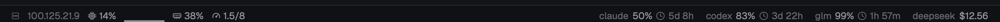

# status-strip

A thin strip above Herdr's status bar.

- **Left — machines:** each connected Linux machine's CPU (last 2 s, plus a 5-minute sparkline of 10 s averages), memory in use and 5-minute load against its cores. Read from `/proc` every 2 s via `exec`; nothing is installed there. Yellow from 70 % CPU / 80 % memory / 80 % of cores, red from 90 / 92 / 120.
- **Right — [9router](https://github.com/decolua/9router) quota:** one chip per provider, with its logo and brand color (Claude, Codex, GLM, DeepSeek, Kimi, Qwen; icons from [LobeHub](https://github.com/lobehub/lobe-icons), MIT). Several accounts of one provider pool into one figure — the mean of each account's tightest window and the soonest reset, or the summed balance — marked `×N`. Hover for the breakdown: each account, then every window it has. Read every minute from 9router's `/api/usage`.
- The CPU sparkline draws 3 px bars scaled to the larger of 25 % and the window's peak, so a calm server still shows shape.



## 9router access

9router's quota API takes the dashboard session or its **CLI token**, not an API key. The CLI token is computed inside the 9router container:

```sh
docker exec <9router-container> node -e "const c=require('crypto'),f=require('fs'),d=process.env.DATA_DIR||'/app/data';console.log(c.createHash('sha256').update(f.readFileSync(d+'/machine-id','utf8').trim()+'9r-cli-auth'+f.readFileSync(d+'/auth/cli-secret','utf8').trim()).digest('hex').slice(0,16))"
```

Put the URL and token in `~/.config/herdr-app/data/9router.conf`, mode 600:

```sh
printf '%s\n' https://router.example.com <token> > ~/.config/herdr-app/data/9router.conf
chmod 600 ~/.config/herdr-app/data/9router.conf
```

The token reaches every 9router dashboard API, like the dashboard password; it is sent only to that 9router. It changes only if the container loses `/app/data`; the strip then says "token refused". Without the file the quota side is empty.

## Install

```sh
cp -R mods/status-strip ~/.config/herdr-app/mods/
# in your layout's work column, above the status block:
#   { "id": "quota", "type": "block", "content": { "mod": "status-strip" }, "size": { "px": 26 } }
herdr-app check ~/.config/herdr-app/mods/status-strip
```

`layouts/my-folders.json` already has it.
